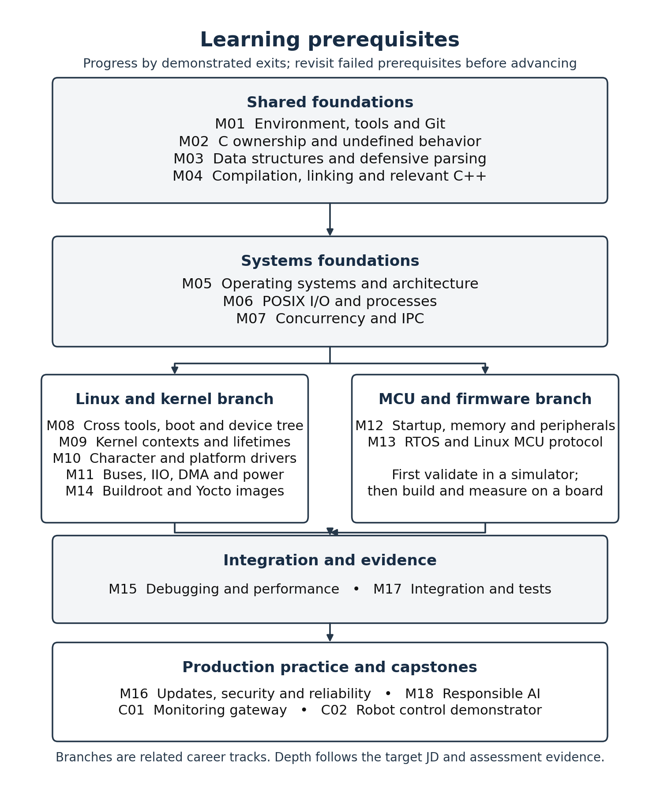
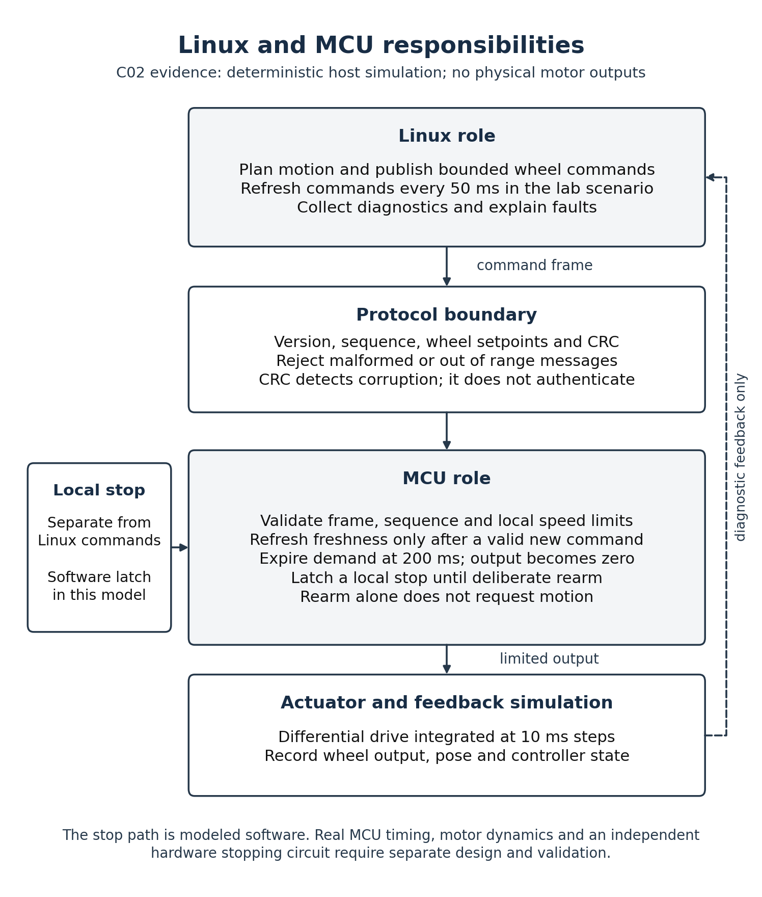
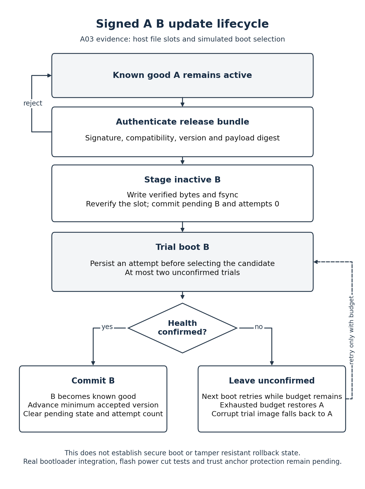

# Handbook diagrams

These original diagrams describe the learning sequence and the authored reference implementations. They do not add validation claims beyond the project evidence. Each PNG is 6.8 inches wide at 220 dpi; the matching SVG and the Python source allow reuse without raster scaling.

## Learning prerequisites

**Caption:** Shared tools, C and build skills lead to OS and POSIX foundations, then Linux kernel and MCU firmware branches. The branches converge on debugging, integration, production practice and the two capstones. Module depth should follow the target role and demonstrated assessments.

Files: `01_prerequisite_map.png` and `01_prerequisite_map.svg`. Native size: 1496 × 1782 pixels.

## Linux and MCU responsibilities

**Caption:** C02 separates motion supervision from local command validation, freshness and stop handling. The supplied evidence comes from a deterministic host simulation. Diagnostic feedback is observational; the diagram does not claim a physical motor controller or an independently validated hardware stop circuit.

Files: `02_linux_mcu_boundary.png` and `02_linux_mcu_boundary.svg`. Native size: 1496 × 1760 pixels.

## Signed A B update lifecycle

**Caption:** A03 authenticates a release before writing the inactive slot, reverifies stored bytes, bounds unconfirmed trials and commits only after health confirmation. Failed or missing confirmation preserves the known good slot and eventually rolls back. The executed artifact is a host file-slot state machine; real bootloader, trust-anchor and power-cut validation remain pending.

Files: `03_signed_ab_lifecycle.png` and `03_signed_ab_lifecycle.svg`. Native size: 1496 × 2002 pixels. For a portrait handbook page, insert at about 6.0 inches wide or constrain its height to leave space for the caption.

## Regeneration and inspection

Run `draw_handbook_diagrams.py` using Python with matplotlib. The source contains all positions, labels and relationships; no image generation or external artwork was used. All three PNGs were opened and visually inspected on 2026-10-27. Labels are readable and contained, arrows preserve their intended direction, and the validation caveats are visible.
